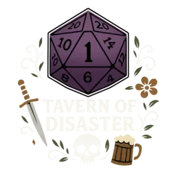
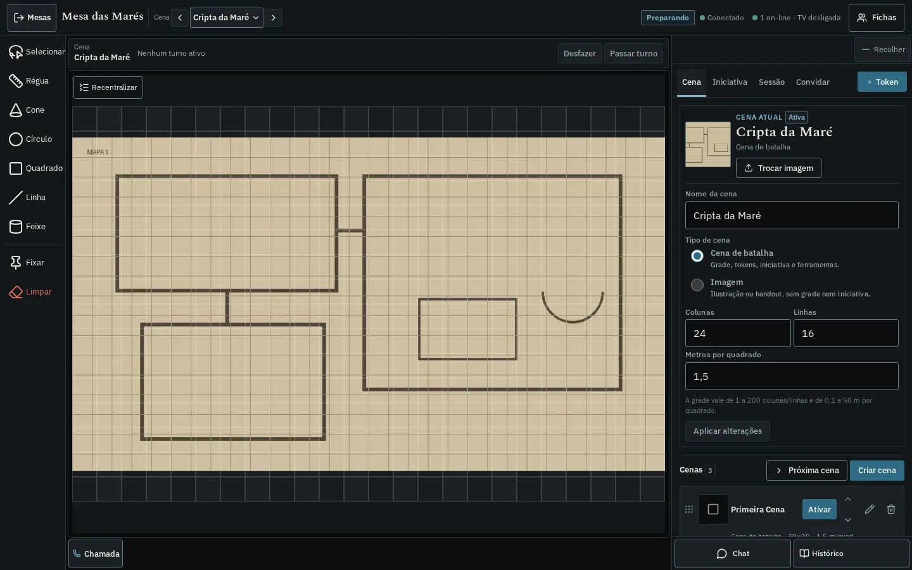
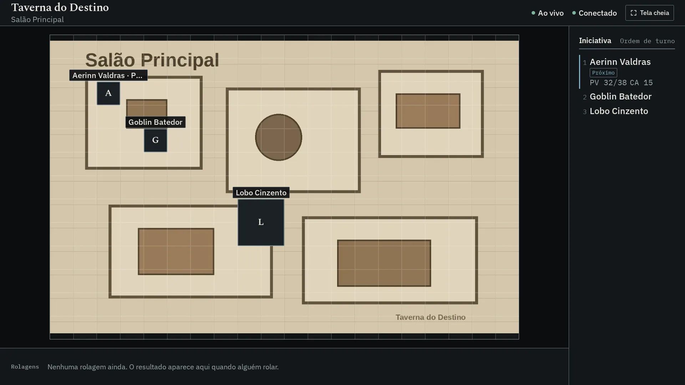
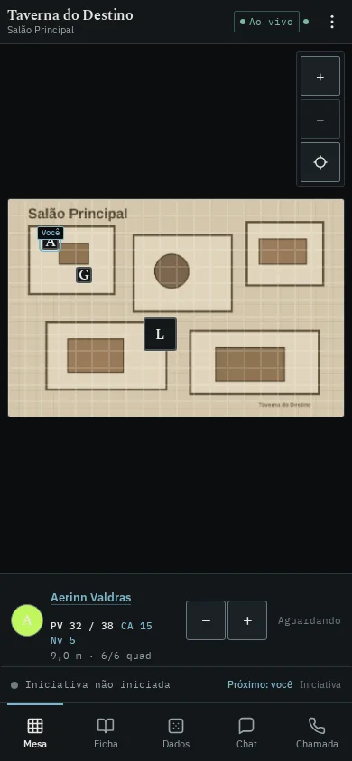
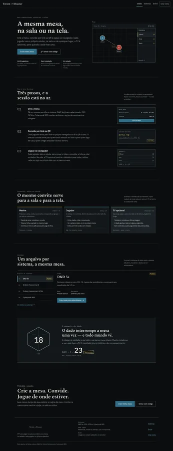
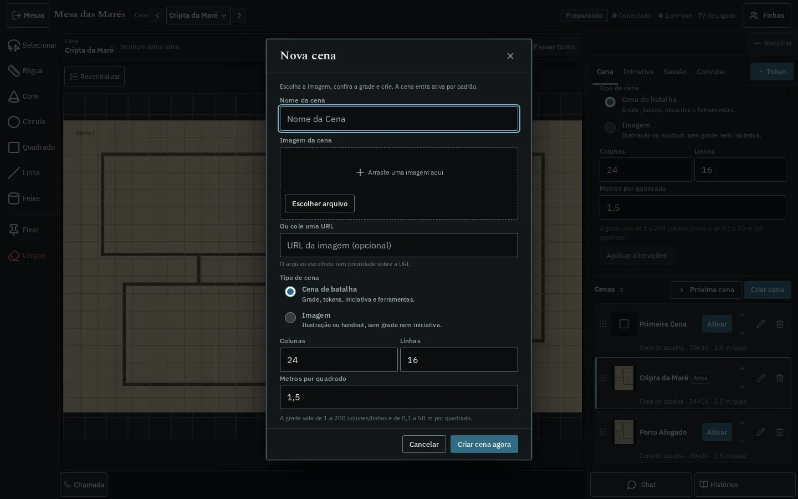

<div align="center">
  
  <h1>Tavern of Disaster</h1>
  <p><strong>A mesa de RPG que cabe na TV, no celular e no navegador.</strong></p>
  <p>VTT presencial-first e online: a TV é o tabuleiro compartilhado, cada celular é o controle de um jogador e a mesma mesa funciona de qualquer lugar.</p>

  <p>
    <a href="https://tavernofdisaster.vercel.app"></a>
    
    <a href="https://github.com/jrchakalo/Tavern-of-Disaster/actions/workflows/ci.yml"></a>
    
  </p>
  <p>
    
    
    
    
  </p>

  <p>
    <a href="https://tavernofdisaster.vercel.app"><strong>Jogar agora</strong></a>
    ·
    <a href="./docs/DESIGN_OVERHAUL.md">Design & UX</a>
    ·
    <a href="./docs/OPERATIONS.md">Operações</a>
    ·
    <a href="https://github.com/jrchakalo/Tavern-of-Disaster/issues">Issues</a>
  </p>
</div>

---

## O que é

Tavern of Disaster é um **virtual tabletop** para campanhas longas de RPG. Ele foi desenhado para a mesa na sala, mas não depende dela:

- **Presencial:** a TV mostra o tabuleiro, a iniciativa e as rolagens; cada jogador usa o próprio celular.
- **Online:** todos entram pelo navegador, com tabuleiro, ficha, dados, chat e chamada de voz/vídeo.
- **Híbrido:** parte da mesa na sala, parte remota, no mesmo estado e na mesma revisão.

O servidor é a fonte da verdade. Toda mutação de estado passa por revisão, autorização por entidade (token → cena → mesa → papel) e resposta `ack`/`error`. Reconectar não deixa a mesa divergente.

**Sistemas:** D&D 5e é o padrão da plataforma. Ordem Paranormal 2 (OP2), OPSH e Cyberpunk RED usam a mesma mesa, com fichas, atributos e presets próprios. Call of Cthulhu é roadmap.

## Screenshots

<table>
  <tr>
    <td width="50%"></td>
    <td width="50%"></td>
  </tr>
  <tr>
    <td align="center"><sub><strong>Mestre</strong> — cena, grade, tokens, iniciativa, fichas, convite e sessão</sub></td>
    <td align="center"><sub><strong>TV</strong> — tabuleiro legível a distância, sem controles e sem debug</sub></td>
  </tr>
  <tr>
    <td width="34%"></td>
    <td width="66%"></td>
  </tr>
  <tr>
    <td align="center"><sub><strong>Jogador</strong> — tabuleiro, ficha, dados, chat, chamada, régua e ping</sub></td>
    <td align="center"><sub><strong>Home</strong> — presencial e online no mesmo convite</sub></td>
  </tr>
</table>

<p align="center">
  
  <br />
  <sub><strong>Cena em um passo</strong> — imagem, tipo, grade e ativação em um único diálogo.</sub>
</p>

## O que está pronto

### Mesa em tempo real
- Estado canônico com `revision`, `sessionSnapshot` e `sessionPatch`; eventos granulares são compatibilidade, não a fonte da verdade.
- Ack/erro em toda mutação, reconexão com ressincronização e broadcast canônico para todos, inclusive quem originou a ação.
- Coordenadas normalizadas de grade; tabuleiro DOM/SVG (sem PixiJS) com medições, pings, auras e tokens multi-célula.
- Autorização por entidade e proteção contra IDOR entre mesas.
- Até **8 jogadores por mesa**; o nono convite é recusado com `409` e mensagem clara.

### Mestre
- Cockpit em **3 zonas**: rail de ferramentas, tabuleiro + barra de turno, painel dockado com **Cena · Iniciativa · Sessão · Convidar**.
- **Cena atual editável:** nome, imagem (upload/URL), tipo (batalha ou imagem), colunas/linhas e metros por quadrado, com “Aplicar alterações”.
- **Nova cena em popup** com imagem, tipo, grade, escala e “Ativar ao criar”; **Próxima cena** ao lado.
- Tokens: criar por toque, inspetor, dono, ficha vinculada, aura, reset de movimento e exclusão confirmada.
- Iniciativa não destrutiva: remover do turno **não apaga o token**; exclusão é ação separada.
- Fichas: criar, listar, abrir, vincular a token e excluir com confirmação.
- Histórico único com **Tudo · Rolagens · Ações**, persistido no servidor (retenção de 7 dias) e hidratado no join/resync: Ações registra cena, sessão, movimento, turno, ficha e remoções, e nada se perde ao recarregar.
- Convite por link/QR, código, Web Share onde o navegador suporta e link da TV com aviso antes de rotacionar.
- Sessão: Preparando → Ao vivo → Pausado → Encerrado, com confirmação para encerrar.
- Pré-chamada com “Entrar com microfone”, “Entrar mudo” e explicação de permissão.

### Jogador
- Shell mobile próprio (`/play/:id`) com **bottom nav**: Mesa · Ficha · Dados · Chat · Chamada.
- Tabuleiro com pinça/pan, “centralizar em mim”, anel “Você”, confirmação de movimento e **Desfazer** por 5 s.
- Turno visível, movimento restante e “Encerrar turno”; sem telemetria de `rev`/role na interface.
- **Régua e ping:** medir dois quadrados, distância em metros e ping compartilhado com a mesa.
- Ficha com criação real, abas fixas e salvamento com guarda de alterações.
- Dados com presets do sistema, rolagens salvas, vantagem/desvantagem e últimas rolagens.
- Chat com menções, não lidas e retry; chamada em sheet com dispositivos, mute, câmera e tela.
- Onboarding sem beco sem saída: criar ficha, vincular token ou pedir ao Mestre.

### TV
- Três zonas: tabuleiro, iniciativa e ticker de rolagens; tipografia legível a 3 m.
- Autenticação por token de display em fragmento, somente leitura, sem chat/chamada/controles.
- **Cenas de imagem** aparecem como handout limpo: sem grade, tokens, iniciativa ou turno; restam apenas o cabeçalho da mesa e a imagem.
- Dado assinatura em ficha de papel com carimbo “REGISTRADO”, SVG real de d4–d20 e respeito a `prefers-reduced-motion`.
- Sem `rev`, role ou debug visível.

### Online e mídia
- Chamada WebRTC em malha com STUN/TURN, mute/deafen, câmera e compartilhamento de tela onde o navegador suporta (Mestre e jogador); o backend já suporta moderação da chamada.
- Chat persistido, menções e mensagens de sistema.
- Fichas e tokens sincronizados; alterações de PV/CA feitas por outro cliente chegam à ficha aberta.
- Upload de mapas, tokens e avatares com quota por mesa e limpeza de assets órfãos.

### Design e acessibilidade
- Direção **“Arquivo Morto”**: dossiê de investigação, grafite frio, azul-tinta, papel como exceção, Spectral + IBM Plex Sans/Mono.
- A identidade não usa roxo/lavanda, gradientes, glassmorphism, emojis como ícone nem microtexto em caixa alta. Roxo aparece **apenas** como uma das cores de régua que o usuário pode escolher no Perfil.
- Contraste AA verificado por script (`npm run check:contrast`), foco visível, alvos ≥44 px nas ações principais, `prefers-reduced-motion`, `lang="pt-BR"`, títulos por rota.
- Assets otimizados: `frontend/public` caiu de ~18 MB para menos de 1 MB.

## Começando

### Docker (tudo em um comando)

```bash
docker compose up --build
```

Abra `http://localhost:8080`. Em uma mesa presencial, os celulares usam
`http://<ip-do-computador>:8080` na mesma rede; o frontend encaminha `/api`,
`/socket.io` e `/uploads`, então todo mundo compartilha a mesma origem.

Defina `JWT_SECRET` no ambiente (ou em um `.env` na raiz) para qualquer uso
além de teste local. Dados persistem nos volumes `mongo-data` e `uploads`.

### Desenvolvimento local

Requisitos: **Node.js 22+**, **MongoDB 7+** (ou Docker), npm.

```bash
# backend
cd backend
npm ci
cp ../.env.example .env      # MONGO_URI e JWT_SECRET
npm run dev                  # http://localhost:3001

# frontend (outro terminal)
cd frontend
npm ci
npm run dev                  # http://localhost:5173
```

O Vite encaminha `/api`, `/socket.io` e `/uploads` para `localhost:3001`.
`frontend/.env.local` é opcional; deixe `VITE_API_URL` vazio para usar a mesma
origem. Variáveis de produção e storage/TURN estão em [`.env.example`](./.env.example)
e [`docs/OPERATIONS.md`](./docs/OPERATIONS.md).

### Primeira mesa em 3 passos

1. Crie uma conta (login por **usuário ou e-mail**).
2. **Criar mesa**, escolha o sistema e copie o link/QR de convite.
3. Abra a cena, envie o mapa, coloque os tokens e **Inicie sessão**. Jogadores entram em `/play/:id`; a TV abre `/display/:id`.

## Como o estado funciona

```
Mestre /table ─┐
Jogador /play ─┼─ Socket.IO ─ revision / ack / sessionPatch ─ Express API ─ MongoDB
TV /display ───┘                                      └─ storage local ou Supabase
```

- **Mestre** (`/table/:id`): cockpit e ferramentas.
- **Jogador** (`/play/:id`): tabuleiro, ficha, dados, chat e chamada.
- **TV** (`/display/:id`): leitura, autenticada por display token no fragmento.
- **Uma revisão por mesa:** patches aplicam listas inteiras (`scenes`, `initiative`,
  `characters`, `tokens`) ou merges por id (`tokenUpdates`, `characterUpdates`); um
  patch com revisão velha pede `requestResync` em vez de aplicar.

### Estrutura do repositório

```
backend/
  src/
    routes/            REST (auth, tables, characters, systems, assets…)
    socketHandlers/    eventos Socket.IO (mesa, token, iniciativa, mídia, chat)
    services/          regras de negócio e autorização por entidade
    models/            Mongoose (User, Table, Scene, Token, Character, Roll…)
    dto/               contrato de estado da sessão
    validation/        schemas Zod
frontend/
  src/
    views/             Home, Login, Register, Tables, Profile, Table, Play, Display…
    components/        tabuleiro DOM/SVG, painéis DM, jornada do jogador, TV, dados
    stores/            Pinia (tableStore é o núcleo da sessão)
    services/          socket, REST, áudio/vídeo, storage, clipboard
    assets/            tokens de design e estilos globais
tests/e2e/             Playwright, caos de 6 clientes, seeds e fake media
docs/                  contratos, operações e decisões
```

## Contratos

| Documento | Assunto |
|---|---|
| [`docs/REALTIME_PROTOCOL.md`](./docs/REALTIME_PROTOCOL.md) | eventos, ack, revisão, autorização por entidade |
| [`docs/TABLE_MODE.md`](./docs/TABLE_MODE.md) | TV + celulares, display token, QR, geometria |
| [`docs/SHEETS_DICE.md`](./docs/SHEETS_DICE.md) | fichas, dados, logs e TTL |
| [`docs/ORDEM_PARANORMAL.md`](./docs/ORDEM_PARANORMAL.md) | OP2/OPSH |
| [`docs/PHASE5_ONLINE_CALL.md`](./docs/PHASE5_ONLINE_CALL.md) | chamada online, mídia e sinalização |
| [`docs/MEDIA_SCENES.md`](./docs/MEDIA_SCENES.md) | upload, assets, quota e cenas |
| [`docs/DESIGN_OVERHAUL.md`](./docs/DESIGN_OVERHAUL.md) | direção visual, IA, ondas, gates e pós-beta |
| [`docs/OPERATIONS.md`](./docs/OPERATIONS.md) | deploy, backup, keep-alive e runbook |
| [`AGENTS.md`](./AGENTS.md) | invariantes e regras para agentes/contribuidores |

## Testes e qualidade

```bash
# backend — Jest + integração Socket.IO
cd backend && npm test && npm run build

# frontend — Vitest, type-check real e build
cd frontend && npm run test:unit && npm run type-check && npm run build
npm run check:contrast        # 45/45 pares WCAG AA

# E2E — 2+ navegadores, fake media; use o Chrome do sistema se preferir
cd tests/e2e && E2E_CHANNEL=chrome npx playwright test

# caos — 6 clientes headless, sem divergência de revisão
cd tests/e2e && node chaos/run.mjs
```

| Gate | Resultado atual |
|---|---|
| Backend | **268/268** |
| Frontend | **559/559** |
| E2E | **80/80** |
| axe (11 rotas, inclui `/profile` e `/play` a 320 px) | **0 critical/serious** |
| Caos (6 clientes) | **PASS** |
| CI (GitHub Actions) | **verde** |
| Contraste | **45/45 AA** |

O CI roda backend, frontend, E2E em `ubuntu-24.04`, caos e Docker. O workflow
de keep-alive mantém o free tier do Render acordado.

## Deploy

- **Frontend:** Vercel — https://tavernofdisaster.vercel.app
- **API:** Render — https://tavern-of-disaster-api.onrender.com (free tier hiberna; o primeiro acesso pode levar ~20 s, mitigado pelo workflow `keepalive.yml`)
- **Banco:** MongoDB Atlas M0
- **Storage:** driver `local` por padrão; Supabase Storage opcional
- **Voz/vídeo:** STUN + TURN (Metered Open Relay) opcional; a produção atual usa STUN e a interface avisa quando não há TURN configurado

O passo a passo, secrets, backup/restore e smoke estão em
[`docs/OPERATIONS.md`](./docs/OPERATIONS.md). A aplicação não commita PDFs de
regras nem segredos.

## Roadmap

Itens ainda fora do beta, em ordem aproximada:

- Fog of war e visão por token
- Múltiplas TVs / espectadores
- Notas de campanha e linha do tempo
- XP, level-up e automação de progressão
- Reset de senha e gestão de conta
- Gravação de sessão e exportação de log
- Moderação da chamada no cockpit (remover participante)
- Medições persistentes para jogadores e biblioteca de templates de cena

## Contribuindo

1. Leia [`AGENTS.md`](./AGENTS.md) e o contrato da área que vai mexer.
2. Trabalhe em branch/worktree própria; não edite `main` diretamente.
3. Rode os gates da seção **Testes e qualidade** — incluindo E2E e caos quando
   houver mudança em Socket.IO.
4. Mudanças de contrato exigem atualização do doc correspondente e teste com
   pelo menos dois clientes.
5. Playtest oficial é **simulado**: E2E com múltiplos navegadores e o caos
   headless de 6 clientes, não com pessoas.

## Licença

MIT. Veja [`LICENSE`](./LICENSE).

## Autor

[<br /><sub><strong>Júnior Silva</strong></sub>](https://github.com/jrchakalo)
